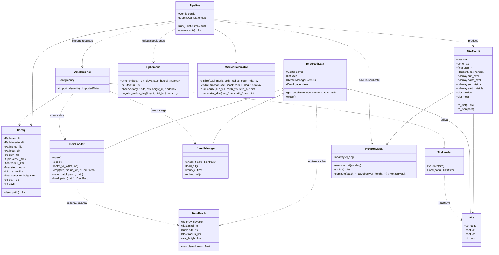
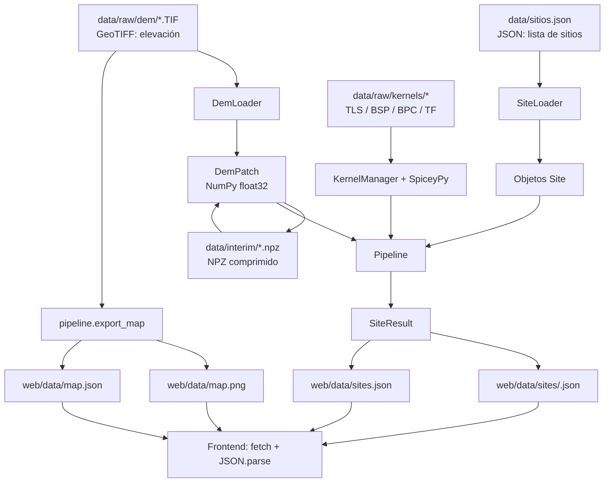
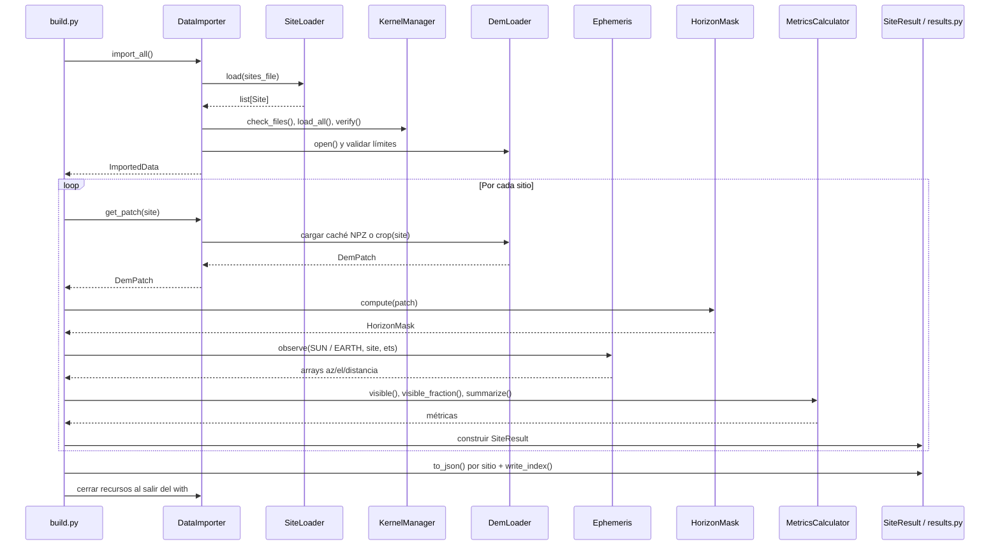
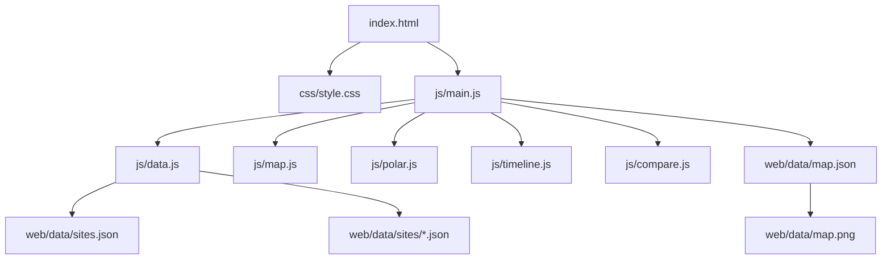
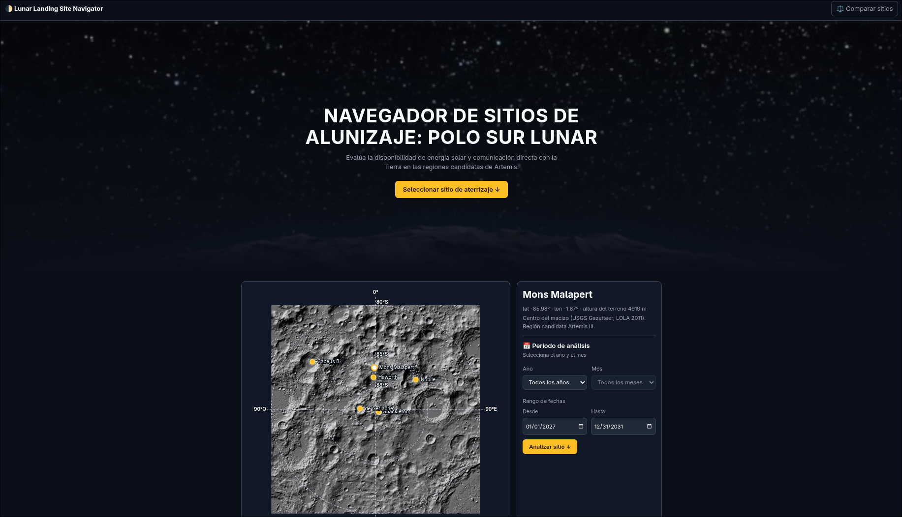
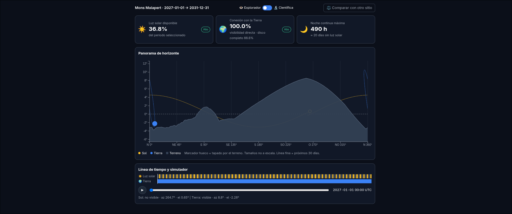

# CLPS Lunar Landing Site Navigator

Herramienta interactiva para explorar y comparar sitios candidatos de alunizaje
en el polo sur lunar. El sistema estima, para cada sitio y a lo largo del
tiempo, la visibilidad del Sol y de la Tierra teniendo en cuenta el horizonte
topográfico local.

> **Alcance científico:** los resultados son estimaciones geométricas basadas
en un DEM, efemérides SPICE y un modelo de horizonte. No constituyen una certificación
de seguridad de aterrizaje ni sustituyen un análisis de ingeniería de misión.

## 1. Objetivo y funcionalidades

El proyecto busca ayudar a comparar condiciones relevantes para una misión lunar:

- Disponibilidad de iluminación solar para generación de energía.
- Visibilidad de la Tierra como aproximación geométrica a la posibilidad de comunicación directa.
- Obstáculos topográficos que elevan el horizonte local.
- Variación temporal de las condiciones de iluminación y visibilidad.
- Comparación entre sitios y selección de intervalos de fechas.

La interfaz web ofrece:

- Mapa polar del polo sur lunar con sitios candidatos.
- Selector de sitio y rango temporal.
- Indicadores de iluminación y visibilidad.
- Panorama del horizonte con las posiciones del Sol y la Tierra.
- Línea de tiempo de visibilidad.
- Comparador entre dos sitios.
- Descarga del JSON de resultados de cada sitio.

## 2. Arquitectura general

El proyecto está dividido en dos partes principales:

1. **Pipeline científico (`pipeline/`)**: importa los datos, carga los kernels SPICE, recorta el DEM, calcula el horizonte, obtiene las posiciones aparentes del Sol y la Tierra, calcula métricas y exporta JSON.
2. **Frontend (`web/`)**: consume los JSON estáticos y presenta el mapa, las métricas, la línea de tiempo y las visualizaciones.

```mermaid
flowchart TD
    A[Fuentes NASA / JPL] --> B[Datos locales: DEM y kernels]
    C[data/sitios.json] --> D[DataImporter]
    B --> D
    D --> E[DemLoader y KernelManager]
    E --> F[Recortes DEM: data/interim/*.npz]
    F --> G[HorizonMask]
    E --> H[Ephemeris: SPICE]
    G --> I[MetricsCalculator]
    H --> I
    I --> J[SiteResult]
    J --> K[web/data/sites/*.json]
    J --> L[web/data/sites.json]
    B --> M[pipeline.export_map]
    M --> N[web/data/map.png + map.json]
    K --> O[Frontend JavaScript]
    L --> O
    N --> O
    O --> P[Mapa, panorama, timeline y comparador]
```



### 2.1 Estructura del repositorio

```text
.
├── data/
│   ├── raw/                    # DEM y kernels descargados (no versionados)
│   │   ├── dem/
│   │   └── kernels/
│   │       ├── lsk/
│   │       ├── spk/
│   │       ├── pck/
│   │       └── fk/
│   ├── interim/                # recortes DEM cacheados en NPZ (no versionados)
│   └── sitios.json             # catálogo de sitios de entrada
├── pipeline/
│   ├── build.py                # orquestación y ejecución del pipeline
│   ├── config.py               # rutas y parámetros
│   ├── importer.py             # importación y validación de recursos
│   ├── sites_loader.py         # lectura y validación de sitios
│   ├── models.py               # Site y DemPatch
│   ├── dem_loader.py           # lectura GeoTIFF y caché NPZ
│   ├── kernels.py              # carga, verificación y descarga lógica SPICE
│   ├── ephemeris.py             # posiciones aparentes Sol/Tierra
│   ├── horizon.py               # cálculo del perfil del horizonte
│   ├── metrics.py               # visibilidad y métricas temporales
│   ├── results.py               # serialización JSON
│   ├── export_map.py            # exportación del hillshade para el mapa
│   ├── sensitivity.py           # análisis de sensibilidad
│   ├── prueba.py                # visualización de recortes DEM para inspección
│   └── tests/                   # pruebas automatizadas
├── web/
│   ├── index.html
│   ├── css/style.css
│   ├── img/                     # imágenes de la interfaz
│   ├── js/
│   │   ├── main.js
│   │   ├── data.js
│   │   ├── map.js
│   │   ├── polar.js
│   │   ├── timeline.js
│   │   └── compare.js
│   └── data/
│       ├── sites.json           # índice para el frontend
│       ├── sites/*.json         # resultados por sitio
│       ├── map.png              # hillshade
│       └── map.json             # límites espaciales del hillshade
├── images/                      # diagramas del proyecto
├── requirements.txt
└── README.md
```

`data/raw/` y `data/interim/` aparecen en `.gitignore`. El ZIP de revisión contiene recortes NPZ, pero no incluye los datos originales de `data/raw/`; por tanto, el DEM y los kernels deben descargarse localmente para volver a ejecutar el pipeline.

## 3. Fuentes de datos

### 3.1 Modelo digital de elevación (DEM)

El valor configurado en `pipeline/config.py` es:

```text
LDEM_80S_80MPP_ADJ.TIF
```

Es un **LOLA Digital Elevation Model (LDEM)** del polo sur lunar, con resolución nominal de 80 metros por píxel y alturas de superficie en metros. El código lo abre con Rasterio y obtiene su CRS y transformación espacial directamente de los metadatos del GeoTIFF.

Fuente del producto y catálogo de DEM: [NASA GSFC – Planetary Geosciences Data Archive, A New View of the Lunar South Pole from LOLA](https://pgda.gsfc.nasa.gov/products/90). La página describe los GeoTIFF polares, su sistema de coordenadas estereográficas y la convención de nombres de los productos. El archivo concreto configurado por el proyecto es `LDEM_80S_80MPP_ADJ.TIF`.

También se menciona como recurso de exploración y contexto cartográfico [NASA Moon Trek](https://trek.nasa.gov/moon/). Moon Trek no es leído directamente por el código del pipeline.

**Ruta local esperada:**

```text
data/raw/dem/LDEM_80S_80MPP_ADJ.TIF
```

### 3.2 Catálogo de sitios

`data/sitios.json` contiene una lista de objetos con estos campos:

| Campo | Tipo | Descripción |
| --- | --- | --- |
| `name` | string | Nombre del sitio |
| `lat` | number | Latitud en grados decimales |
| `lon` | number | Longitud en grados decimales |
| `note` | string | Nota descriptiva y referencia consignada |

Los seis sitios incluidos en el archivo del proyecto son:

- Mons Malapert
- Haworth
- Shackleton
- de Gerlache
- Nobile
- Cabeus B

Las notas de `data/sitios.json` atribuyen las coordenadas o descripciones a distintas referencias: USGS Gazetteer/LOLA 2011, Wikipedia, ESA, IAU Transactions XXII B y the-moon.us. Algunas coordenadas se describen explícitamente como aproximadas. El repositorio no incluye una bibliografía completa ni enlaces individuales para todas esas notas; conviene completar y verificar esas referencias antes de tratar las coordenadas como definitivas.

### 3.3 Kernels SPICE

Los kernels configurados en `Config.kernel_files` son archivos públicos de la infraestructura NAIF/JPL. Se cargan mediante SpiceyPy (`spice.furnsh`) y se descargan de la distribución genérica de NAIF; no se convierten a otro formato durante el pipeline.

| Archivo | Tipo | Uso en este proyecto |
| --- | --- | --- |
| `naif0012.tls` | LSK | Tabla de segundos intercalares. Permite convertir UTC a ET (Ephemeris Time) mediante `str2et` y volver a UTC mediante `et2utc`. |
| `de440s.bsp` | SPK | Efemérides planetarias. Se usa para obtener posiciones de `SUN` y `EARTH` con `spkpos`. |
| `moon_pa_de440_200625.bpc` | PCK binario | Orientación de la Luna en el modelo de ejes principales asociado a DE440. Se utiliza para transformaciones de marcos. |
| `moon_de440_250416.tf` | FK | Define marcos de referencia lunares y sus relaciones. El código comprueba el marco `MOON_PA_DE440` en `KernelManager` y usa `MOON_ME_DE440_ME421` en `Ephemeris`. |

Rutas locales esperadas:

```text
 data/raw/kernels/lsk/naif0012.tls
 data/raw/kernels/spk/de440s.bsp
 data/raw/kernels/pck/moon_pa_de440_200625.bpc
 data/raw/kernels/fk/moon_de440_250416.tf
```

Fuentes oficiales de descarga:

- [NAIF – Generic Kernels](https://naif.jpl.nasa.gov/pub/naif/generic_kernels/)
- [LSK – naif0012.tls](https://naif.jpl.nasa.gov/pub/naif/generic_kernels/lsk/naif0012.tls)
- [SPK – de440s.bsp](https://naif.jpl.nasa.gov/pub/naif/generic_kernels/spk/planets/de440s.bsp)
- [PCK – moon_pa_de440_200625.bpc](https://naif.jpl.nasa.gov/pub/naif/generic_kernels/pck/moon_pa_de440_200625.bpc)
- [FK – moon_de440_250416.tf](https://naif.jpl.nasa.gov/pub/naif/generic_kernels/fk/moon_de440_250416.tf)

#### Descarga de kernels

Desde la raíz del repositorio:

```bash
mkdir -p data/raw/kernels/{lsk,spk,pck,fk}

wget -P data/raw/kernels/lsk \
  https://naif.jpl.nasa.gov/pub/naif/generic_kernels/lsk/naif0012.tls

wget -P data/raw/kernels/spk \
  https://naif.jpl.nasa.gov/pub/naif/generic_kernels/spk/planets/de440s.bsp

wget -P data/raw/kernels/pck \
  https://naif.jpl.nasa.gov/pub/naif/generic_kernels/pck/moon_pa_de440_200625.bpc

wget -P data/raw/kernels/fk \
  https://naif.jpl.nasa.gov/pub/naif/generic_kernels/fk/moon_de440_250416.tf
```

El DEM debe descargarse desde el catálogo PGDA enlazado arriba y guardarse en `data/raw/dem/` con el nombre exacto configurado. El repositorio no contiene un script de descarga automática del DEM ni de los kernels.

## 4. Modelo de clases del pipeline

El siguiente diagrama resume las clases y dependencias observadas en el código Python:



### 4.1 Responsabilidad de los módulos

| Módulo | Responsabilidad |
| --- | --- |
| `config.py` | Define rutas, archivos y parámetros predeterminados. |
| `sites_loader.py` | Lee `data/sitios.json`, crea objetos `Site` y valida coordenadas y nombres. |
| `models.py` | Define `Site` y `DemPatch`, que representan el sitio y su recorte de elevación. |
| `kernels.py` | Comprueba que existan los kernels, los carga, verifica que SPICE pueda calcular una distancia Tierra-Luna razonable y los descarga de memoria al terminar. |
| `dem_loader.py` | Abre el GeoTIFF, transforma latitud/longitud a coordenadas del raster, recorta el DEM y gestiona la caché NPZ. |
| `importer.py` | Coordina la validación y apertura de sitios, kernels y DEM. `ImportedData` administra su ciclo de vida. |
| `ephemeris.py` | Genera la malla temporal ET y calcula azimut, elevación y distancia del Sol/Tierra desde cada sitio. |
| `horizon.py` | Calcula el ángulo máximo del terreno en cada dirección de azimut. |
| `metrics.py` | Determina visibilidad del centro y fracción visible de los discos; resume porcentajes y duraciones. |
| `build.py` | Orquesta el cálculo para todos los sitios y guarda resultados JSON. |
| `results.py` | Define el contrato JSON de cada sitio y el índice `sites.json`. |
| `export_map.py` | Genera el hillshade `map.png` y los límites espaciales `map.json`. |
| `sensitivity.py` | Compara resultados variando radio del recorte y número de azimuts. |

## 5. Proceso de importación y procesamiento

### 5.1 Importación de recursos

`DataImporter.import_all()` realiza estas operaciones:

1. Lee `data/sitios.json` mediante `SiteLoader`.
2. Comprueba que estén presentes los cuatro kernels declarados en `Config.kernel_files`.
3. Comprueba que exista el DEM configurado.
4. Carga los kernels con `KernelManager.load_all()`.
5. Ejecuta `KernelManager.verify()` si `verify=True` (valor predeterminado). La verificación comprueba el marco `MOON_PA_DE440`, calcula la distancia Tierra-Luna y comprueba que esté entre 350 000 y 410 000 km.
6. Abre el DEM con `DemLoader` y comprueba que las coordenadas de todos los sitios estén dentro de sus límites.
7. Devuelve un objeto `ImportedData`. Al salir del bloque `with`, cierra el DEM y descarga los kernels.

### 5.2 Recorte y caché del DEM

Para cada sitio, `ImportedData.get_patch()` busca primero:

```text
data/interim/<nombre-del-sitio>.npz
```

La caché se reutiliza si coinciden el radio del recorte, la resolución en metros por píxel y las coordenadas del sitio. Si no existe, no se puede leer o no coincide, el recorte se vuelve a calcular desde el GeoTIFF y se guarda con `numpy.savez_compressed`.

El recorte es una matriz NumPy `float32` de elevaciones en metros. Los píxeles sin datos se representan con `NaN`. `site_px` almacena la posición fraccionaria del sitio dentro del recorte como `(columna, fila)`.

### 5.3 Cálculo del horizonte

`HorizonMask.compute()` lanza rayos desde el sitio en `n_azimuths` direcciones. En cada rayo muestrea el DEM mediante interpolación bilineal y calcula la elevación angular del terreno respecto al observador. El resultado es un vector de elevaciones del horizonte:

```text
el_deg[k] = elevación máxima del terreno en el azimut k * 360 / n_az
```

La configuración predeterminada utiliza 360 azimuts, es decir, un perfil cada grado. Los valores no finitos se serializan como `null` en JSON.

### 5.4 Cálculo de efemérides

`Ephemeris.time_grid()` convierte la fecha UTC inicial a ET con `spice.str2et()` y crea una secuencia temporal en segundos SPICE. Para cada instante y para cada sitio, `Ephemeris.observe()`:

1. Obtiene la posición del cuerpo (`SUN` o `EARTH`) respecto de la Luna con `spice.spkpos()`.
2. Usa el marco `J2000` y la corrección de aberración `LT+S`.
3. Transforma el vector al marco lunar `MOON_ME_DE440_ME421` mediante `spice.pxform()`.
4. Calcula el vector local este-norte-arriba y devuelve azimut, elevación y distancia.

La matriz resultante tiene forma `(N, 3)` y columnas `[azimut_deg, elevacion_deg, distancia_km]`. El radio angular aparente se calcula con los radios físicos definidos en `Ephemeris.BODY_RADIUS_KM` y la distancia de cada instante.

### 5.5 Visibilidad y métricas

`MetricsCalculator` compara la elevación del centro del Sol o de la Tierra con la elevación del horizonte en el mismo azimut. El criterio del centro se cumple cuando:

```text
elevacion_del_cuerpo > elevacion_del_horizonte
```

Además, `visible_fraction()` estima qué fracción del disco aparente queda por encima del horizonte. El código usa 41 franjas para aproximar esa fracción.

Métricas exportadas:

| Campo | Significado |
| --- | --- |
| `pct_sun` | Porcentaje de instantes en que el centro del Sol está visible. |
| `pct_earth` | Porcentaje de instantes en que el centro de la Tierra está visible. |
| `pct_both` | Porcentaje de instantes en que ambos centros están visibles simultáneamente. |
| `max_dark_h` | Mayor racha continua sin visibilidad del centro del Sol, en horas. |
| `max_no_earth_h` | Mayor racha continua sin visibilidad del centro de la Tierra, en horas. |
| `sun_energy_pct` | Promedio porcentual de la fracción visible del disco solar; se usa como aproximación proporcional a la energía recibida. |
| `pct_sun_any` | Porcentaje de instantes en que se ve alguna parte del disco solar. |
| `pct_sun_full` | Porcentaje de instantes en que el disco solar está completamente visible. |
| `pct_earth_any` | Porcentaje de instantes en que se ve alguna parte del disco terrestre. |
| `pct_earth_full` | Porcentaje de instantes en que el disco terrestre está completamente visible. |

## 6. Formatos de datos y transferencia entre archivos

Esta sección describe los formatos que efectivamente aparecen en el código.

### 6.1 Flujo de archivos



### 6.2 Tabla de entradas y salidas

| Origen | Formato | Lectura/procesamiento | Destino | Formato |
| --- | --- | --- | --- | --- |
| `data/sitios.json` | JSON (lista de objetos) | `SiteLoader.load()` | Objetos `Site` en memoria | Dataclass Python |
| `data/raw/dem/LDEM_80S_80MPP_ADJ.TIF` | GeoTIFF | `DemLoader.crop()` / Rasterio | Recorte de elevación | `numpy.ndarray` `float32` |
| Recorte DEM en memoria | Arrays y escalares NumPy/Python | `DemLoader.save_patch()` | `data/interim/<sitio>.npz` | NPZ comprimido |
| `data/interim/<sitio>.npz` | NPZ | `DemLoader.load_patch()` | `DemPatch` | Dataclass + ndarray |
| Kernels SPICE | TLS, BSP, BPC, TF | `KernelManager.load_all()` / SpiceyPy | Datos SPICE en memoria | No se exportan a JSON |
| Posiciones y horizonte | Arrays NumPy | `Pipeline.run()` / `SiteResult` | `web/data/sites/<sitio>.json` | JSON |
| Resumen de sitios | Objetos `SiteResult` | `write_index()` | `web/data/sites.json` | JSON |
| DEM original | GeoTIFF | `pipeline.export_map` | `web/data/map.png` | PNG raster |
| Límites del DEM | Metadatos Rasterio | `pipeline.export_map` | `web/data/map.json` | JSON |

### 6.3 Estructura del archivo NPZ

El recorte se guarda con `numpy.savez_compressed()` y contiene estas claves:

| Clave | Tipo / forma | Unidad o significado |
| --- | --- | --- |
| `elevation` | ndarray `float32`, forma `(filas, columnas)` | Elevación del terreno en metros; `NaN` indica ausencia de dato. |
| `pixel_m` | escalar | Tamaño del píxel en metros. |
| `site_px` | array de 2 elementos | Coordenadas fraccionarias `(columna, fila)` del sitio dentro del recorte. |
| `radius_km` | escalar | Radio del recorte en kilómetros. |
| `name` | string | Nombre del sitio. |
| `lat` | escalar | Latitud del sitio en grados. |
| `lon` | escalar | Longitud del sitio en grados. |
| `note` | string | Nota del sitio. |

El NPZ es una caché intermedia de Python/NumPy; el frontend no lo consume.

### 6.4 Estructura del JSON por sitio

Ruta: `web/data/sites/<slug-del-sitio>.json`.

```json
{
  "schema": 1,
  "site": {
    "name": "Nombre del sitio",
    "lat": -85.0,
    "lon": 0.0,
    "note": "Descripción"
  },
  "t0": "2027-01-01T00:00:00Z",
  "step_h": 1.0,
  "n": 8760,
  "horizon": [0.0, 0.1, null],
  "sun": {
    "az": [0.0, 1.0],
    "el": [2.0, 2.1],
    "visible": [1, 1],
    "fraction": [1.0, 0.85]
  },
  "earth": {
    "az": [180.0, 181.0],
    "el": [5.0, 4.9],
    "visible": [1, 1],
    "fraction": [1.0, 1.0]
  },
  "metrics": {},
  "meta": {}
}
```

El ejemplo es esquemático; los arrays reales contienen `n` elementos. Campos:

- `schema`: versión del contrato de serialización (`1`).
- `site`: identificación y coordenadas del sitio.
- `t0`: instante inicial en UTC, con sufijo `Z`.
- `step_h`: separación entre muestras en horas.
- `n`: cantidad de muestras temporales.
- `horizon`: elevación del terreno para cada azimut; en la configuración habitual son 360 valores, de 0° a 359°. Los huecos se representan con `null`.
- `sun` y `earth`: `az` (azimut en grados), `el` (elevación en grados), `visible` (0/1) y `fraction` (fracción visible del disco, entre 0 y 1).
- `metrics`: métricas agregadas descritas en la sección anterior.
- `meta`: parámetros y diagnósticos de la ejecución.

`SiteResult.to_dict()` redondea azimut/elevación a dos decimales y fracción visible a cuatro decimales. `visible` se convierte a enteros. `json.dumps(..., allow_nan=False)` impide escribir valores NaN/Infinity; los huecos del horizonte se convierten previamente a `null`.

### 6.5 Índice `web/data/sites.json`

Es una lista JSON con una entrada por sitio. Cada entrada incluye:

```json
{
  "name": "Mons Malapert",
  "lat": -85.98,
  "lon": -1.67,
  "note": "Nota del sitio",
  "file": "sites/mons-malapert.json",
  "metrics": {
    "pct_sun": 36.77,
    "pct_earth": 100.0
  }
}
```

El índice permite al frontend construir el catálogo de sitios y el mapa. `web/js/data.js` descarga primero `data/sites.json` mediante `fetch()` y después carga cada archivo indicado en `file`.

### 6.6 Archivos del mapa

- `web/data/map.png`: hillshade del DEM, generado a 1200 × 1200 píxeles por defecto.
- `web/data/map.json`: límites `left_m`, `right_m`, `top_m` y `bottom_m` del raster en metros. `map.js` usa esos límites para ubicar la imagen de fondo en el SVG.

## 7. Diagrama de secuencia del procesamiento



## 8. Diagramas de componentes del frontend



| Archivo | Función |
| --- | --- |
| `main.js` | Inicializa la interfaz, carga los datos, gestiona el sitio seleccionado y coordina las vistas. |
| `data.js` | Carga JSON, convierte índices temporales a fechas y calcula métricas para rangos seleccionados. |
| `map.js` | Dibuja el mapa polar SVG y los marcadores de sitios. |
| `polar.js` | Dibuja el horizonte y las trayectorias/posiciones del Sol y la Tierra. |
| `timeline.js` | Dibuja bloques consecutivos de visibilidad y permite desplazarse a un instante. |
| `compare.js` | Compara métricas de dos sitios. |

La visualización utiliza D3 desde el HTML. Si D3 no carga, `main.js` muestra un mensaje de error que indica cómo descargar una copia local.

## 9. Instalación y ejecución

### 9.1 Requisitos

- Python compatible con la sintaxis utilizada por el proyecto (Python 3.10 o posterior recomendado por el uso de uniones `|` y dataclasses tipadas).
- Los paquetes declarados en `requirements.txt`.
- El DEM y los cuatro kernels SPICE en las rutas descritas.
- Un navegador moderno para la interfaz.

### 9.2 Preparar el entorno

Desde la raíz del repositorio:

```bash
python -m venv .venv
source .venv/bin/activate
python -m pip install --upgrade pip
pip install -r requirements.txt
```

### 9.3 Verificar importación de datos y kernels

```bash
python -m pipeline.importer
python -m pipeline.kernels
```

El primer comando valida sitios, DEM y kernels, e informa de la resolución del DEM y de los recortes. El segundo verifica la carga de los kernels y calcula una distancia Tierra-Luna de control.

### 9.4 Ejecutar el pipeline

```bash
python -m pipeline.build
```

Parámetros disponibles:

```bash
python -m pipeline.build --start 2027-01-01T00:00:00 --days 365 --step 1
```

- `--start`: fecha/hora inicial UTC.
- `--days`: duración del análisis en días.
- `--step`: separación entre muestras en horas.

El resultado se escribe en `web/data/`:

```text
web/data/
├── sites.json
└── sites/
    ├── mons-malapert.json
    ├── haworth.json
    ├── shackleton.json
    ├── de-gerlache.json
    ├── nobile.json
    └── cabeus-b.json
```

### 9.5 Exportar el mapa de relieve

```bash
python -m pipeline.export_map
```

Genera `web/data/map.png` y `web/data/map.json`. El tamaño predeterminado es 1200 × 1200; `main(size=...)` puede invocarse desde Python para cambiarlo.

### 9.6 Abrir la aplicación web

No abrir `index.html` directamente con `file://`, porque el navegador puede bloquear `fetch()` de los JSON. Iniciar un servidor HTTP:

```bash
cd web
python -m http.server 8000
```

Abrir en el navegador:

```text
http://localhost:8000
```

### 9.7 Ejecutar pruebas

Desde la raíz:

```bash
pytest -q
```

Algunas pruebas de integración se omiten automáticamente si faltan el DEM o los kernels reales en `data/raw/`. Las pruebas unitarias de validación, geometría, métricas y serialización pueden ejecutarse sin todos los datos originales.

## 10. Parámetros predeterminados del pipeline

Los valores proceden de `pipeline/config.py`:

| Parámetro | Valor predeterminado | Descripción |
| --- | ---: | --- |
| `dem_file` | `LDEM_80S_80MPP_ADJ.TIF` | DEM que se abre. |
| `radius_km` | 150 km | Radio de cada recorte topográfico. |
| `step_hours` | 1 h | Separación temporal entre muestras. |
| `n_azimuths` | 360 | Direcciones utilizadas para el horizonte. |
| `observer_height_m` | 0 m | Altura del observador sobre el terreno local. |
| `start_utc` | `2027-01-01T00:00:00` | Inicio del análisis. |
| `days` | 365 | Duración predeterminada del análisis. |

## 11. Análisis de sensibilidad

`pipeline/sensitivity.py` permite comprobar cuánto varían las métricas al modificar el radio del recorte y el número de azimuts:

```bash
python -m pipeline.sensitivity "Mons Malapert"
```

Opciones relevantes:

```bash
python -m pipeline.sensitivity "Mons Malapert" \
  --days 30 \
  --radii 40 100 150 \
  --azimuths 360 1440 \
  --dem LDEM_80S_80MPP_ADJ.TIF
```

El programa imprime el porcentaje de rayos truncados por el borde del DEM y métricas para cada combinación. `pipeline/prueba.py` es una utilidad de inspección visual de los recortes.

## 12. Pruebas y validaciones

La carpeta `pipeline/tests/` contiene pruebas para:

- Validación y lectura de sitios.
- Detección de kernels y verificación SPICE.
- Lectura y caché de recortes DEM.
- Direcciones de azimut y cálculo del horizonte.
- Cálculo de efemérides.
- Cálculo de métricas.
- Estructura y consistencia de los JSON exportados.

La prueba de construcción comprueba, entre otras cosas, que los arrays `az`, `el` y `visible` tengan la misma longitud `n`, que el horizonte tenga la cantidad configurada de azimuts y que las métricas estén dentro de rangos válidos.

## 13. Consideraciones, límites y verificaciones pendientes

1. **Coordenadas de sitios:** algunas notas de `data/sitios.json` dicen que las coordenadas son aproximadas o citan fuentes sin enlace directo. Se recomienda revisar cada ubicación contra una fuente cartográfica primaria antes de usarla en análisis de misión.
2. **Cobertura del DEM:** los rayos pueden alcanzar el borde del raster antes de llegar al radio solicitado. El pipeline calcula `truncated_pct` para advertirlo.
3. **Horizonte sin dato:** cuando la elevación del horizonte no es finita, `MetricsCalculator` asume elevación 0° para la comparación de visibilidad. El JSON del perfil, en cambio, conserva el hueco como `null`.
4. **Energía solar:** `sun_energy_pct` es el promedio de la fracción visible del disco solar. No incluye por sí solo eficiencia de paneles, orientación, degradación, sombras de hardware ni balance energético de una nave.
5. **Comunicaciones:** la visibilidad geométrica de la Tierra es una condición de línea de vista simplificada; no modela antenas, potencia, enlaces RF, relieves de infraestructura ni restricciones operacionales.
6. **Caché:** `data/interim/*.npz` depende del DEM, resolución, coordenadas y radio. El código valida algunos de esos parámetros antes de reutilizarla; si se cambia el DEM por otro archivo con la misma resolución, la caché no registra un hash del contenido del DEM.
7. **Kernels:** el repositorio define los nombres y las rutas de kernels, pero no incluye un gestor de descarga ni checksums de verificación. La disponibilidad de los archivos debe comprobarse antes de ejecutar.

### 13.1 Diferencia entre la configuración y los JSON incluidos

En la copia revisada, `Config.days` tiene como valor predeterminado **365 días**, pero los JSON ya presentes en `web/data/sites/` indican `t0 = 2027-01-01T00:00:00Z`, `step_h = 1` y `n = 43824`, que corresponde a 1826 días de muestras horarias (hasta 2031-12-31 23:00 UTC). Por tanto, esos JSON no corresponden al valor predeterminado actual de `days=365`; pudieron generarse con una ejecución configurada con otra duración. Al regenerarlos, el rango temporal dependerá de los parámetros usados en `pipeline.build`.

Además, en los JSON de la copia revisada, Shackleton, de Gerlache y Haworth presentan arrays de visibilidad y métricas completamente en cero. Esto no se debe ocultar en una publicación: conviene revisar esos resultados y confirmar que los datos de entrada, marcos SPICE, coordenadas y archivos JSON sean los esperados antes de interpretar o presentar sus métricas.

## 14. Tecnologías utilizadas

- **Python:** orquestación y cálculos científicos.
- **NumPy:** arrays, muestreo y operaciones numéricas.
- **Rasterio:** lectura del DEM GeoTIFF.
- **PyProj:** transformaciones entre coordenadas geográficas y proyectadas.
- **SpiceyPy / CSPICE:** carga de kernels, efemérides y transformaciones de marcos.
- **Matplotlib:** exportación del hillshade.
- **pytest:** pruebas automatizadas.
- **HTML, CSS y JavaScript:** aplicación web.
- **D3.js:** visualizaciones SVG.

Las versiones de dependencias fijadas se encuentran en `requirements.txt`.

## 15. Referencias

- NASA/JPL NAIF. [Generic Kernels](https://naif.jpl.nasa.gov/pub/naif/generic_kernels/).
- NASA GSFC Planetary Geosciences Data Archive. [A New View of the Lunar South Pole from LOLA](https://pgda.gsfc.nasa.gov/products/90).
- NASA. [Moon Trek](https://trek.nasa.gov/moon/).
- NASA GSFC Planetary Geosciences Data Archive. [High-Resolution LOLA Topography for Lunar South Pole Sites](https://pgda.gsfc.nasa.gov/products/78).

---

**Nota de reproducibilidad:** para reproducir una ejecución se deben conservar los parámetros usados (`start_utc`, `days`, `step_hours`, `radius_km`, `n_azimuths`, `observer_height_m`), la versión del DEM y los cuatro kernels SPICE. El JSON exportado guarda parte de estos parámetros en `meta`, pero no contiene hashes de los archivos de entrada.

## 16. Anexos




