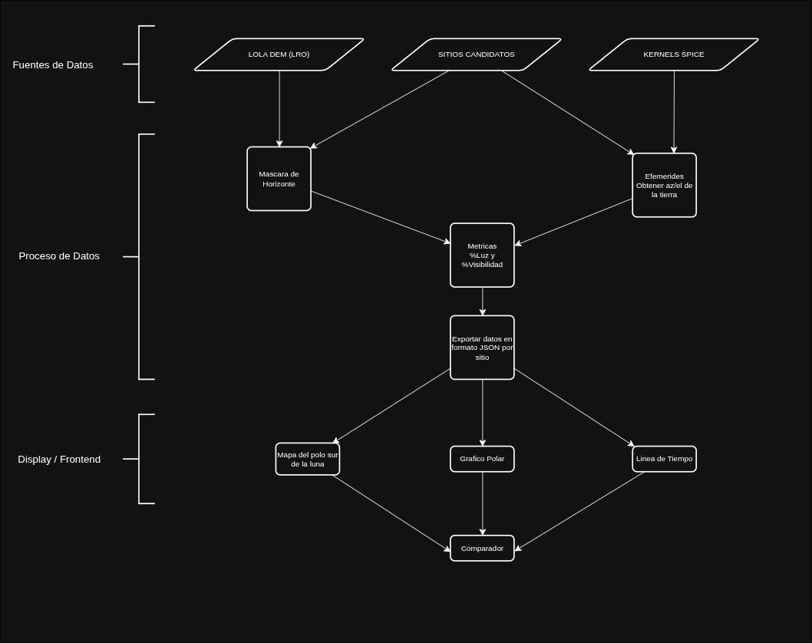

# CLPS Lunar Landing Site Navigator

## Objetivos:
Realizar una herramienta interactiva que ayude a decidir donde y cuando aterrizar en el polo sur de la luna, mostrando como se ven el sol y la tierra desde cada sitio a lo largo del tiempo

## Marco Teorico
El polo sur es un lugar especial en la luna debido a:
- El sol casi no sube del horizonte
- Hay zonas de luz casi permanente y zonas de sombra permanente
- La Tierra no siempre esta a la vista

Para tener mas contexto para que un satelite pueda aterrizar sobre la luna necesita:
1. Energia solar. El mayor tiempo posible (usan paneles solares para cargar energia)
2. Comunicacion con la Tierra. Por esto es necesario que la tierra sea visible sobre el horizonte.

## Alcances
- Mapa del polo sur
- Selector de fecha
- Linea de tiempo con los periodos de luz y visibilidad de la tierra
- Comparador de fechas o lugares
- Grafico del horizonte 

## Datos sugeridos 
Moon Trek -> https://trek.nasa.gov/moon/

LRO -> https://pgda.gsfc.nasa.gov/products/

## Diagrama de Flujo

## Importacion de Datos
Hecho en pyton
[Flujo de Importacion](images/FlujoImportacionDeDatos.png)

