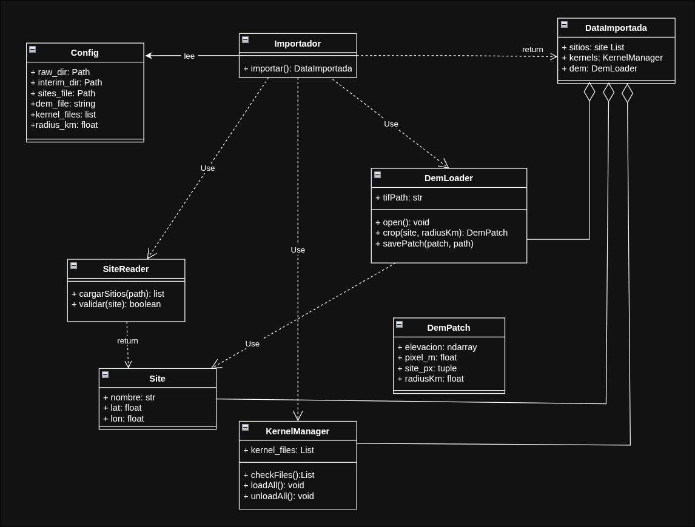

# CLPS Lunar Landing Site Navigator

## Objetivos

Realizar una herramienta interactiva que ayude a decidir donde y cuando
aterrizar en el polo sur de la luna, mostrando como se ven el sol y la
tierra desde cada sitio a lo largo del tiempo

## Marco Teorico

El polo sur es un lugar especial en la luna debido a:

- El sol casi no sube del horizonte
- Hay zonas de luz casi permanente y zonas de sombra permanente
- La Tierra no siempre esta a la vista

Para tener mas contexto para que un satelite pueda aterrizar sobre la luna necesita:

1. Energia solar. El mayor tiempo posible (usan paneles solares para cargar energia)
2. Comunicacion con la Tierra. Por esto es necesario que la tierra sea visible
sobre el horizonte.

## Alcances

- Mapa del polo sur
- Selector de fecha
- Linea de tiempo con los periodos de luz y visibilidad de la tierra
- Comparador de fechas o lugares
- Grafico del horizonte

## Datos sugeridos

Moon Trek -> [https://trek.nasa.gov/moon/]

LRO -> [https://pgda.gsfc.nasa.gov/products/]

## Diagrama de Flujo

## Importacion de Datos

data/
|- sitios.json
|
|- raw/
|  |- dem/
|  |  |-LDEM_80S_40MPP_ADJ.TIF
|  |
|  |- kernels/
|     |- lsk/
|     |   |- naif0012.tls
|     |- spk/
|     |   |- de440s.bsp
|     |- pck/
|     |   |- moon_pa_de440_200625.bpc
|     |- fk/
|         |- moon_de440_250416.tf
|- interim/

- no se suben los kernels al repositorio para evitar subir archivos pesados
- lsk: convierte el tiempo UTC a ET que es el tiempo entendido por SPICE
- spk: posicion de la Tierra y el Sol respecto a la luna
- pck: datos de la orientacion lunar de alta precision
- fk: es el que utiliza los datos del pck y define los marcos lunares
- dem: tiene los datos topograficos de la luna para hacer los calculos mas exactos

## Pipeline de Datos y exportacion a Formato Json

